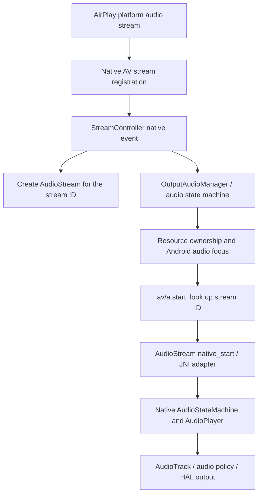

# Wireless CarPlay audio: code-level findings

Researched offline on 30 October 2026. No device was contacted and no runtime source or installed package was changed. The failed handoff in `wireless-data/20261028-222218/` is **not successful-session audio evidence**. Older prose claims about “zero streams” are not a substitute for a time-aligned successful wireless capture.

**Wireless audio is plausibly achievable; the existing evidence does not establish a silicon limit.** There is a shared vendor playback pipeline, a verified stream-102 software defect, and explicit resource/focus and BT-teardown policy. Which one causes the observed wireless silence remains unconfirmed. A successful wired session proves some formats and playback routes work; it does not prove every format or stream negotiated over Wi-Fi reaches that working path.

**Most promising concrete code fix:** add stream 102 to the main-stream lookup in `av/a.R(int)`, **if the successful wireless session negotiates 102**. This is a real defect in the original APK, not a decompiler guess. The most useful first car experiment is an instrumented, native-audio-enabled wireless playback trial that records stream ID, focus/resource state, and actual AudioTrack activity. Another uninstrumented true/false toggle would leave the main alternatives unresolved.

**What triggers playback**

The visible chain is:



`libAirPlay.so` imports `AudioStreamCreate`, `AudioStreamPrepare`, `AudioStreamStart`, output callbacks and audio converters. `libAirPlaySupport.so` contains the platform binding names and the `libAudioStream.so`/`libAudioConverter.so` library names. Those two platform libraries were not found among the supplied files. Therefore the exact argument mapping at that boundary cannot be fully reconstructed here.

The native AV core exports `StreamControllerManager::addAStream(...)` and `getAudioStream(int,long&)`. Native events enter Java through `StreamController.postEventFromNative`; event 0 first creates the Java AudioStream object, then notifies its stream listener. See [StreamController.java:56](/Users/saqibsuleman/code/personal/carplay/decompiled/CarplayService/sources/com/autochips/carplay/av/StreamController.java:56), [av/c.java:26](/Users/saqibsuleman/code/personal/carplay/decompiled/CarplayService/sources/com/autochips/carplay/av/c.java:26), and [av/b.java:14](/Users/saqibsuleman/code/personal/carplay/decompiled/CarplayService/sources/com/autochips/carplay/av/b.java:14).

`b/r.h()` classifies the stream and sends event 10 to the main or alternate audio state machine. Main playback requests Android focus and, on focus grant, calls `startMainAudioStreaming` → `av/a.start(id)` → `AudioStream.start()` → JNI. See [b/r.java:22](/Users/saqibsuleman/code/personal/carplay/decompiled/CarplayService/sources/com/autochips/carplay/b/r.java:22), [b/s.java:70](/Users/saqibsuleman/code/personal/carplay/decompiled/CarplayService/sources/com/autochips/carplay/b/s.java:70), [b/s.java:259](/Users/saqibsuleman/code/personal/carplay/decompiled/CarplayService/sources/com/autochips/carplay/b/s.java:259), and [AudioStream.java:54](/Users/saqibsuleman/code/personal/carplay/decompiled/CarplayService/sources/com/autochips/carplay/av/AudioStream.java:54).

Native inspection confirms the continuation: `libcarplay_av_jni.so::AudioStreamAdapter::start()` at `0x3118` checks out an existing stream and calls its virtual start method; `libcarplay_av_core.so::AudioStream::start()` at `0x150d8` posts the native start message; `AudioPlayer::onMessageReceived()` at `0x11360`, specifically the call at `0x115d0`, invokes `AudioTrack::start()`. These are direct disassembly observations, not deductions from symbol names alone. The precise native format/configuration functions `AudioStream::prepare(...)` and `AudioPlayer::configAudioTrack(...)` reside in the supplied binary's encrypted section, limiting conclusions about every configuration branch.

The same resource controller is constructed without a wireless/USB branch ([service/g.java:236](/Users/saqibsuleman/code/personal/carplay/decompiled/CarplayService/sources/com/autochips/carplay/service/g.java:236)). I found **no explicit USB or native-iAP2-flag gate in the reviewed Java output-audio path or the inspected JNI start routine**. This does not prove that every hidden native setup/advertisement branch is identical between transports. The USB-only `setIAP2StateNative` notification exists in the plugin adapter, but the audio-start chain does not call it ([plugin/a.java:253](/Users/saqibsuleman/code/personal/carplay/decompiled/CarplayService/sources/com/autochips/carplay/plugin/a.java:253)). Spoofing that event is not a justified first audio fix.

**Ranked root-cause hypotheses**

The ranking prioritizes concrete code evidence and discriminating tests. Confidence in a mechanism is distinguished from confidence that the successful wireless session actually exercises it.

1. **Main-high stream 102 is created but cannot be started through the Java lookup.**

   **Evidence:** creation stores both 100 and 102 in `qk`; the output manager explicitly recognizes 102 with entertainment audio type 3. But `av/a.R()` returns `qk` only for 100 and `ql` only for 101. Both `start(102)` and `stop(102)` therefore return `-2`. See [av/b.java:16](/Users/saqibsuleman/code/personal/carplay/decompiled/CarplayService/sources/com/autochips/carplay/av/b.java:16), [b/m.java:65](/Users/saqibsuleman/code/personal/carplay/decompiled/CarplayService/sources/com/autochips/carplay/b/m.java:65), [av/a.java:14](/Users/saqibsuleman/code/personal/carplay/decompiled/CarplayService/sources/com/autochips/carplay/av/a.java:14), and [av/a.java:45](/Users/saqibsuleman/code/personal/carplay/decompiled/CarplayService/sources/com/autochips/carplay/av/a.java:45).

   I verified the original archived APK's DEX, not just the patched tree: `av/a.R` at DEX offset `0x5a5fc` has a packed-switch with two entries starting at `0x64`, covering exactly 100 and 101. The readable smali agrees ([av/a.smali:44](/Users/saqibsuleman/code/personal/carplay/patched-carplayservice/decoded/smali/com/autochips/carplay/av/a.smali:44)). An offline test of the actual lookup/start methods with a populated fake stream-102 object reproduced the `-2` returns.

   **Confidence:** high that the defect exists; conditional/medium as the explanation of wireless media silence. The public constant calls 102 `STREAM_ID_MAIN_HIGH_AUDIO`; there is no supplied successful trace proving wireless selects it. Do not automatically rename it “wireless” or “buffered” audio ([CarplayCommon.java:143](/Users/saqibsuleman/code/personal/carplay/decompiled/autochips-framework/sources/com/autochips/carplay/CarplayCommon.java:143)). It also does not independently explain every call/microphone failure.

   **Fix if true:** route IDs 100 and 102 to `qk` in `R()`, retaining 101 → `ql`, and log start/stop return codes. Check the lifetime assumption that only one main stream occupies `qk`. The patch fixes both start and stop dispatch, rather than forcing a different native stream ID.

   **Decisive test:** successful wireless music produces `created, streamID:102` / `onCreated ...102... audioType:3` and `startMainAudioStreaming:102`, followed by a logged start result `-2` and no matching AudioTrack. After the lookup fix, repeat the same case and require advancing playback frames and audible sound. A session using only stream 100 moves this hypothesis down the list.

2. **The audio resource/focus state never reaches the playback-ready combination, and the true/false enable tests were interpreted too broadly.**

   **Evidence:** `setAudioEnable` queues message 261 and returns zero. The resource controller converts true to main-audio state-machine event 0 and false to event 1. The boolean helper sets/clears `sI`; the true branch checks call/speech state and Android audio mode, and may initiate an ownership transfer. Main stream playback separately requests focus and starts only after a grant. See [CarplayService.java:373](/Users/saqibsuleman/code/personal/carplay/decompiled/CarplayService/sources/com/autochips/carplay/service/CarplayService.java:373), [b/e.java:66](/Users/saqibsuleman/code/personal/carplay/decompiled/CarplayService/sources/com/autochips/carplay/b/e.java:66), [b/s.java:214](/Users/saqibsuleman/code/personal/carplay/decompiled/CarplayService/sources/com/autochips/carplay/b/s.java:214), and [b/s.java:91](/Users/saqibsuleman/code/personal/carplay/decompiled/CarplayService/sources/com/autochips/carplay/b/s.java:91).

   The archived setting `ro.atc.carplay.audio_enable_ctl=0` selects automatic start on stream creation even without the explicit enabled bit. In this implementation false is not a universal “release the CarPlay route and preserve A2DP” command. See [b/m.java:25](/Users/saqibsuleman/code/personal/carplay/decompiled/CarplayService/sources/com/autochips/carplay/b/m.java:25), [b/s.java:141](/Users/saqibsuleman/code/personal/carplay/decompiled/CarplayService/sources/com/autochips/carplay/b/s.java:141), and [getprop.txt:587](/Users/saqibsuleman/code/personal/carplay/survey/20261026-215704/info/getprop.txt:587). Current device values must still be recorded.

   `getMainAudio` tracks negotiated resource ownership, not an Android output device. Controller=1 and accessory=2 are explicit constants; ownership changes feed the audio state machines. See [CarplayCommon.java:119](/Users/saqibsuleman/code/personal/carplay/decompiled/autochips-framework/sources/com/autochips/carplay/CarplayCommon.java:119), [service/p.java:123](/Users/saqibsuleman/code/personal/carplay/decompiled/CarplayService/sources/com/autochips/carplay/service/p.java:123), and [b/e.java:108](/Users/saqibsuleman/code/personal/carplay/decompiled/CarplayService/sources/com/autochips/carplay/b/e.java:108).

   **Confidence:** high that these prerequisites exist; medium that one is the observed blocker. Decompiled `b/s.java` has impossible duplicated control flow, so use its bytecode/logs rather than literal duplicated branches when diagnosing a specific transition.

   **Fix if true:** make the existing vendor enable/focus/ownership sequence complete after a real connection. Retry an enable intent only when the connection/resource state makes it actionable; diagnose a missing mode-change acknowledgement or a denied/lost focus request. Correct stale call/SCO state at its source. A new competing AudioManager focus request from the screen app, or a blind global `setMode(0)`, could obscure the vendor state machine and disrupt calls.

   **Decisive test:** stream 100/102 exists, but the trace ends in a focus denial, call/communication mode, `borrowAudio`/ownership timeout, or absence of `startMainAudioStreaming`; correlate `mainAudioEntity`, `focusRequestStatus`, `dumpsys audio` and the service state-machine dump. A focus grant followed by native start and advancing frames moves the investigation downstream.

3. **Wireless never negotiates/prepares the expected audio stream, or its format/media transport fails before playback.**

   **Evidence:** stream creation precedes all the focus/start logic. A working video session does not itself demonstrate an audio stream. AirPlay imports platform audio preparation and converter functions; native configuration carries sample rate, format ID, channels and audio type. Those are possible differing branches between successful wired and wireless sessions (`libAirPlay.so` audio imports; `libcarplay_av_core.so::AudioStream::prepare(...)` and its format-description string). The full platform audio shim is missing from the supplied files and parts of native preparation are encrypted.

   **Confidence:** plausible, currently unmeasured. The failed-IP session cannot establish “iOS does not send audio during successful wireless CarPlay.” Nor can wired playback prove that the wireless session negotiates the same codec, stream type, ports or receiver capability flags.

   **Fix if true:** repair the specific unsupported/missing audio capability, format negotiation, platform preparation, or media-port reachability shown by the capture. Choose this before changing HAL routes if no stream is being created. No evidence currently selects a particular property, codec override or firewall rule.

   **Decisive test:** during confirmed wireless video/touch and active music aimed at CarPlay, capture receiver setup/errors and native stream events, plus AP packet headers/UDP endpoints. Compare the same media operation wired. If wireless has no audio create/prepare while wired does, focus-only and stream-102 lookup fixes are downstream of the failure. If preparation starts and fails, retain the exact format/error. TCP 7000 ESTABLISHED alone does not verify an audio media path.

4. **AudioTrack is running, but audio policy, volume, or the head unit's external source path sends it somewhere inaudible.**

   **Evidence:** the native AV core uses AudioTrack, and the vendor output state machine handles focus and duck volume. The saved audio policy's primary default output is named **Wired Headphones**, not Speaker ([audio_policy_configuration.xml:47](/Users/saqibsuleman/code/personal/carplay/survey/20261026-215704/configs/etc/audio_policy_configuration.xml:47)). That label is an Android output-device designation; it is not proof of a USB-CarPlay requirement. A blind “force speaker” workaround could choose a different output from the working car amplifier path.

   Native symbols also include TinyALSA playback. The saved `persist.carplay.alsa.enable=false` favors investigating the existing Android route first; it does not establish the current setting or justify toggling raw ALSA ([getprop.txt:204](/Users/saqibsuleman/code/personal/carplay/survey/20261026-215704/info/getprop.txt:204), `libcarplay_av_core.so` AudioPlayer/AudioTrack/TinyALSAProxy symbols).

   **Confidence:** plausible, medium-low until an active track carrying advancing frames is shown.

   **Fix if true:** reproduce the **working wired output device, gain and external audio-source selection** for the corresponding native stream. Correct the identified focus/route/mute transition. Do not guess `AudioManager.setParameters` keys or force a raw PCM device from symbol strings.

   **Decisive test:** successful wireless creates a track owned by the CarPlay process, focus is granted and frame counters advance, but policy/output/mute/source differs from the audible wired control. Compare full AudioFlinger and audio-policy dumps, stream volume, output device/patch and ALSA status. This hypothesis is weak if there is no AudioTrack to route.

5. **Deliberate vendor Bluetooth teardown destroys the A2DP workaround; bridge contention may add disruption but is unproven as the cause of missing native Wi-Fi audio.**

   **Evidence:** session-connected can disable the whole adapter when `ro.atc.carplay.disable_bt` is true. Independently, session-control argument 1 goes through `service/i.F()` to Bluetooth-adapter message 5, which can call `ej()` to disconnect HFP and A2DP sink. Setting `disable_bt=0` avoids the first path but does not suppress the per-device path. See [c/a.java:124](/Users/saqibsuleman/code/personal/carplay/decompiled/CarplayService/sources/com/autochips/carplay/c/a.java:124), [c/a.java:140](/Users/saqibsuleman/code/personal/carplay/decompiled/CarplayService/sources/com/autochips/carplay/c/a.java:140), [c/a.java:345](/Users/saqibsuleman/code/personal/carplay/decompiled/CarplayService/sources/com/autochips/carplay/c/a.java:345), [service/r.java:118](/Users/saqibsuleman/code/personal/carplay/decompiled/CarplayService/sources/com/autochips/carplay/service/r.java:118), and [service/i.java:124](/Users/saqibsuleman/code/personal/carplay/decompiled/CarplayService/sources/com/autochips/carplay/service/i.java:124).

   The archived `disable_bt` value is already 0 ([getprop.txt:590](/Users/saqibsuleman/code/personal/carplay/survey/20261026-215704/info/getprop.txt:590)). This directly challenges a property-only fix. The reference author says native sound is unfinished and attributes it to a BT conflict, but provides no causal trace in those passages ([README.md:18](/Users/saqibsuleman/code/personal/carplay/headunit-carplay-ref/README.md:18), [GUIDE.md:126](/Users/saqibsuleman/code/personal/carplay/headunit-carplay-ref/docs/GUIDE.md:126)). “In progress” is not proof of a working fix or a hardware prohibition.

   **Confidence:** high that teardown policy exists; the exact observed trigger needs logs. Low that merely sharing the BT controller prevents Wi-Fi PCM decoding/playback. I found no corresponding “iAP2 socket present → refuse AudioStream.start” condition in the reviewed output path. The hardware's A2DP-sink role does not by itself demonstrate that RFCOMM and A2DP cannot coexist.

   **Fix if true:** for A2DP preservation, address the precise per-device teardown policy, retaining native-mode transitions intentionally. For measured dialer contention, pause actual redial during an established session and confirm that it stays paused. These fixes do not independently create a missing native audio stream. Do not turn off the entire BT adapter as the first experiment: the reference guide reports that doing so can also stop the hotspot, confounding the audio test ([GUIDE.md:384](/Users/saqibsuleman/code/personal/carplay/headunit-carplay-ref/docs/GUIDE.md:384)).

   **Decisive test:** align `onSessionControl:1` → `disconnect bluetooth device`/`disconnect device` with A2DP/HFP state loss and the native audio pipeline. If native audio fails earlier without any teardown or redial, the BT-conflict explanation is weakened. If native frames play while A2DP is deliberately disconnected, the teardown is part of handover rather than the missing decoder.

**What setAudioEnable actually means, and why both values can fail**

There is no `setAudioEnableNative` in the plugin interface. The native plugin receives **mode-change requests** generated by the resource machinery through `sendChangeModeRequestNative`; actual playback reaches JNI through AudioStream. See [CarplayPluginInterface.java:30](/Users/saqibsuleman/code/personal/carplay/decompiled/CarplayService/sources/com/autochips/carplay/plugin/CarplayPluginInterface.java:30), [plugin/a.java:160](/Users/saqibsuleman/code/personal/carplay/decompiled/CarplayService/sources/com/autochips/carplay/plugin/a.java:160), and [b/s.java:246](/Users/saqibsuleman/code/personal/carplay/decompiled/CarplayService/sources/com/autochips/carplay/b/s.java:246).

Thus true returning 0 means the service accepted a queued request, not that the phone granted audio ownership, focus was acquired, a stream existed, or a sample played. False does not reverse independent session-control BT teardown and, with automatic audio control enabled by configuration, does not universally suppress auto-start. Both values can leave the same stream-ID defect, missing preparation, denied focus, or wrong route untouched. The screen app's comments claiming an inherent wireless limitation and guaranteed A2DP preservation exceed what this code establishes ([Watcher.java:131](/Users/saqibsuleman/code/personal/carplay/headunit-carplay-ref/carplay-screen/src/app/carplayscreen/Watcher.java:131)).

There is no third boolean value. The additional prerequisites are negotiated stream existence/format, resource ownership, audio focus/mode, and a working output path. The session state also affects whether message 261 is forwarded, deferred or consumed; check the resource-controller log rather than relying solely on Watcher's `[ok]` line. In the no-vendor-iAP2 fallback, `service/v` can accept a receiver session and transition through `t` into child `r`, where audio-enable is forwarded. This weakens a blanket “missing USB event makes the Java audio enable unreachable” theory ([service/v.java:80](/Users/saqibsuleman/code/personal/carplay/decompiled/CarplayService/sources/com/autochips/carplay/service/v.java:80), [service/t.java:25](/Users/saqibsuleman/code/personal/carplay/decompiled/CarplayService/sources/com/autochips/carplay/service/t.java:25), [service/r.java:69](/Users/saqibsuleman/code/personal/carplay/decompiled/CarplayService/sources/com/autochips/carplay/service/r.java:69)).

One diagnostic trap is especially important: `b/r.h()` reports stream state 0 immediately on **creation**; the service stores that in RemoteDevices and distributes callbacks. `getStreamState` reads this cache, with 1 as a missing-entry default. It does not query AudioTrack's play head. A reported STARTED therefore is insufficient evidence of audible playback, and a missing cache entry does not prove native preparation never happened. See [b/r.java:31](/Users/saqibsuleman/code/personal/carplay/decompiled/CarplayService/sources/com/autochips/carplay/b/r.java:31), [service/n.java:261](/Users/saqibsuleman/code/personal/carplay/decompiled/CarplayService/sources/com/autochips/carplay/service/n.java:261), and [service/aa.java:37](/Users/saqibsuleman/code/personal/carplay/decompiled/CarplayService/sources/com/autochips/carplay/service/aa.java:37). Likewise, the JNI adapter's valid-object path returns zero after dispatching start; asynchronous native playback can still fail.

**Smallest experiments, in order**

| Experiment/change | Expected value | Risk |
|---|---|---|
| Log main-audio ownership, stream-created/state callbacks, and actual start results; use explicit native audio enable for one successful wireless music trial | Identifies the failed stage and whether 102 is involved | Low for screen-app logging; vendor start-result instrumentation requires a rebuilt vendor APK |
| If 102 is observed, extend `R()` to return the existing main object for 102 | Repairs a verified dispatch defect with a very small code change | Medium deployment risk; preserve the original vendor package and test wired regression |
| If a stream exists but focus/ownership is blocked, repair that specific vendor transition | Uses the existing playback architecture | Depends on the transition; avoid blanket focus/mode overrides |
| If frames advance but are inaudible, reproduce the wired route/source/gain | Targets the proven downstream difference | Moderate; select only an observed working route |
| Change BT teardown policy or raw ALSA/routing configuration | Useful only after matching evidence | Higher; can affect calls, hotspot continuity or hardware audio ownership |

The current Watcher leaves `onAudioInfo` and `onStreamStateChanged` empty and logs only the screen resource owner ([Watcher.java:310](/Users/saqibsuleman/code/personal/carplay/headunit-carplay-ref/carplay-screen/src/app/carplayscreen/Watcher.java:310)). Add ERROR-priority logs for those callbacks and `state.getMainAudio()`, plus an initial resource snapshot after registration. Log stream ID/type explicitly; stream 101 is alternate output, while call/recognition types use additional full-duplex handling. Do not diagnose every audio class from a music-only test.

For the explicit native-enabled trial, set `debug.cp.cpaudio=1` **before connecting**. Watcher reads it when its connection/initial-connected handler calls `enableCarplayAudio`; changing the property alone during an existing session does not invoke that method ([Watcher.java:139](/Users/saqibsuleman/code/personal/carplay/headunit-carplay-ref/carplay-screen/src/app/carplayscreen/Watcher.java:139), [Watcher.java:302](/Users/saqibsuleman/code/personal/carplay/headunit-carplay-ref/carplay-screen/src/app/carplayscreen/Watcher.java:302)). This repeats the enable experiment with the missing observability, rather than asserting that true alone is a new fix.

**Decisive capture for the next successful wireless session**

Run from a root device shell using the existing `su 0` path. Do not clear logcat. For this native-enabled trial, start recording and set the override **before a fresh connection**, confirm actual screen/touch operation, and require the Watcher log to show that it invoked `setAudioEnable(true)`. Then play known music with the phone's destination set to CarPlay. Record whether the phone is playing or paused and which head-unit source is selected. Use the same music, volume and probes for an audible wired control. Keep captures local; they can contain peer identifiers.

```sh
D=/data/local/tmp/cp-audio-$(date +%Y%m%d-%H%M%S)
mkdir -p "$D"
logcat -b all -d -v threadtime > "$D/pre.log" 2>&1
logcat -b all -v threadtime > "$D/live.log" 2>&1 &
AUDIO_LOG_PID=$!
getprop ro.atc.carplay.audio_enable_ctl > "$D/audio_enable_ctl.txt"
getprop ro.atc.carplay.disable_bt > "$D/disable_bt.txt"
getprop persist.carplay.alsa.enable > "$D/alsa_enable.txt"
getprop debug.cp.cpaudio > "$D/screen_audio_override_before.txt"
setprop debug.cp.cpaudio 1
```

After a **successful wireless connection**, mark the moment music begins and take two snapshots while it should be audible:

```sh
log -p e -t CP_AUDIO_PROBE 'successful wireless screen; native music trial begins'
for AUDIO_TAKE in 1 2; do
  date > "$D/time-$AUDIO_TAKE.txt"
  cat /proc/uptime >> "$D/time-$AUDIO_TAKE.txt"
  dumpsys audio > "$D/audio-$AUDIO_TAKE.txt" 2>&1
  dumpsys media.audio_flinger > "$D/flinger-$AUDIO_TAKE.txt" 2>&1
  dumpsys media.audio_policy > "$D/policy-$AUDIO_TAKE.txt" 2>&1
  dumpsys activity service com.autochips.carplay/.service.CarplayService > "$D/carplay-$AUDIO_TAKE.txt" 2>&1
  ps -A | grep -E 'com.autochips.carplay|audioserver|com.cpbridge' > "$D/processes-$AUDIO_TAKE.txt"
  ip -s link show ap0 > "$D/ap0-$AUDIO_TAKE.txt" 2>&1
  cat /proc/net/udp /proc/net/udp6 > "$D/udp-$AUDIO_TAKE.txt" 2>&1
  cat /proc/asound/cards /proc/asound/pcm > "$D/alsa-$AUDIO_TAKE.txt" 2>&1
  for AUDIO_PROC in /proc/asound/card*/pcm*p/sub*/status /proc/asound/card*/pcm*p/sub*/hw_params; do
    [ -r "$AUDIO_PROC" ] && { echo "$AUDIO_PROC"; cat "$AUDIO_PROC"; }
  done >> "$D/alsa-$AUDIO_TAKE.txt" 2>&1
  sleep 5
done
kill "$AUDIO_LOG_PID"
```

The service component above was verified in the original APK manifest. The snapshots are read-only; the explicit debug override is the one test setting. Restore its recorded value after the experiment, before a later reconnect.

Keep the full logs, then extract this timeline:

```sh
grep -aiE 'CP_AUDIO_PROBE|CarPlayScreen|onSessionCreated|AirPlay.*session|CARPLAY_SESSION|onModesChanged|onSessionControl|CarplayResourceController|OutputAudio|AlternateAudio|AudioStream|StreamController|AudioPlayer|AudioTrack|AudioFlinger|AudioPolicy|focusRequestStatus|startMainAudioStreaming|disconnect bluetooth device|disconnect device:|force to disable bluetooth|a2dp sink' "$D/pre.log" "$D/live.log" > "$D/audio-timeline.txt"
```

If an existing `tcpdump` is available, record AP headers before connecting/playing with `tcpdump -i ap0 -nn -s 96 -w /data/local/tmp/cp-audio-headers.pcap 'not tcp port 5555'`, and stop it after the trial. `/proc/net/udp` shows sockets, not packet arrival; header capture/counters distinguish a missing media path. Do not infer an audio stream's port solely from TCP 7000.

Read the result in this order: **successful session → audio stream creation/format → stream 100/101/102 dispatch → resource/focus grant → native start → active track and advancing frames → selected output/patch/gain → audible speakers**. Check underruns/data availability too: advancing output counters can include silence, so they alone do not prove meaningful decoded samples reached the mixer. If the first missing step is identified, the next change can be small and targeted. Absence of DEBUG lines alone is not proof a stage did not happen; correlate callbacks, return values, dumps and the recorded logging configuration.

**Bottom line:** the hardware-limit verdict is unsupported. The most promising first trial is an instrumented successful wireless native-audio attempt, with stream 102 dispatch as the first concrete fix to apply if that stream is negotiated. A2DP teardown and the Bluetooth workaround should be diagnosed separately from whether Wi-Fi audio reaches the native playback pipeline.
